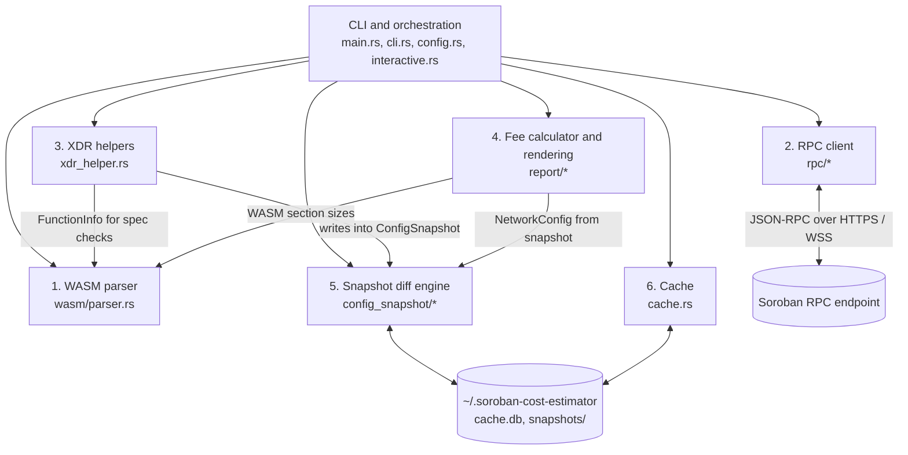
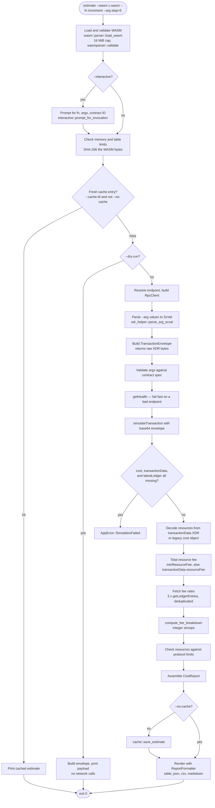
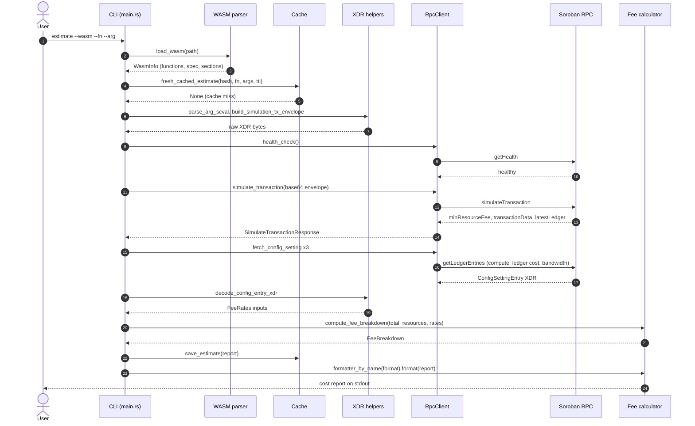
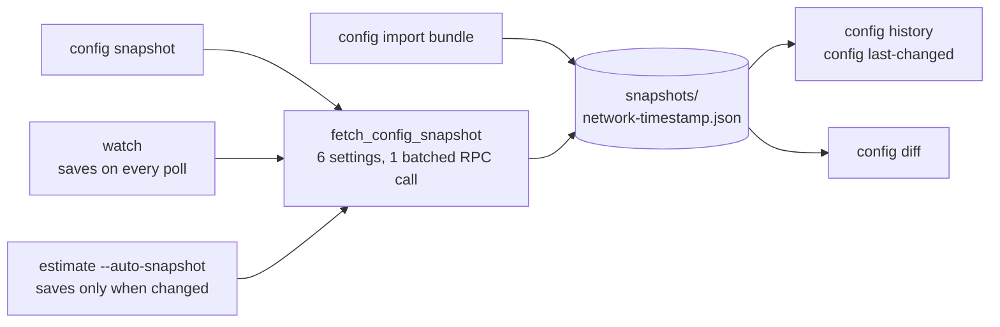

# Architecture

This document is for contributors. It explains how `soroban-cost-estimator`
is put together: which subsystem owns what, how data moves from a CLI
invocation to a rendered cost report, and which invariants every change must
preserve. It assumes familiarity with [Soroban](https://soroban.stellar.org/)
and the [Stellar RPC](https://developers.stellar.org/docs/data/apis/rpc)
interface.

If you only have five minutes, read [The six layers](#the-six-layers),
look at the [simulation pipeline](#simulation-pipeline-estimate) diagram, and
skim [Design invariants](#design-invariants).

## Overview

`soroban-cost-estimator` is a single-binary CLI. For the `estimate` family of
commands it:

1. parses a compiled `.wasm` file to discover exported functions and the
   contract spec;
2. builds a minimal `TransactionEnvelope` and sends it to the network's
   `simulateTransaction` RPC method;
3. decodes the XDR in the response to recover resource usage and the
   authoritative resource fee;
4. splits that fee into non-refundable and refundable portions using the
   network's own config-sourced rates;
5. stores the result in a local cache and renders it as a table, JSON, CSV,
   or Markdown.

For the `config` family it fetches the six on-chain `ConfigSetting*` entries
that drive Soroban pricing, stores them as versioned JSON snapshots, and
diffs snapshots to detect pricing drift — flagging cached estimates that the
drift has made stale.

Three networks are built in (`testnet`, `mainnet`, `futurenet`). Any other
endpoint can be supplied with `--rpc-url` or the `[rpc_urls]` table in
`config.toml`.

## The six layers

The core of the crate is six subsystems. The CLI layer (`main.rs`, `cli.rs`)
sits on top and orchestrates them; it holds no domain logic of its own beyond
choosing which layers to call and in what order.

| # | Layer | Modules | Responsibility | Talks to the network? |
|---|---|---|---|---|
| 1 | **WASM parser** | `wasm/parser.rs` | Load, size-check, and validate a `.wasm` file; enumerate exports; decode `contractspecv0` and `contractmetav0`; account for section sizes | No |
| 2 | **RPC client** | `rpc/client.rs`, `rpc/retry.rs`, `rpc/simulate.rs`, `rpc/config.rs`, `rpc/ws.rs` | JSON-RPC 2.0 transport with deduplication, retry, rate limiting, and failover; typed wrappers for `simulateTransaction`, `getLedgerEntries`, `getHealth`, `getLatestLedger` | Yes — the only layer that does |
| 3 | **XDR helpers** | `xdr_helper.rs` | Build the simulation envelope; parse `--arg` values and contract IDs; decode `ConfigSettingEntry` XDR into the snapshot model | No |
| 4 | **Fee calculator** | `report/fee_calc.rs`, `report/cost_report.rs`, `report/formatter.rs`, `report/diff.rs` | Integer stroop arithmetic for the fee breakdown; assemble the `CostReport`; render it in every output format | No |
| 5 | **Snapshot diff engine** | `config_snapshot/model.rs`, `store.rs`, `diff.rs`, `history.rs` | Model the six config settings; persist snapshots; diff them field by field; derive change history; decide the drift exit code | No |
| 6 | **Cache** | `cache.rs`, `paths.rs` | SQLite store of past estimates keyed by WASM hash, function, and args; TTL reuse, LRU eviction, schema migration, staleness checks | No |

Supporting modules outside the six layers:

- `cli.rs` — `clap` derive definitions for every command and flag.
- `config.rs` — discovers and applies `config.toml` defaults
  (built-in default < config file < explicit flag).
- `interactive.rs` — `estimate --interactive` prompts, validated against the
  contract spec.
- `error.rs` — the single `AppError` enum and `AppResult<T>` alias used by
  every layer.

### How the layers depend on each other

Arrows point from caller to callee. Only the CLI layer fans out to everything;
the layers themselves form a shallow, acyclic graph, and only the RPC client
reaches the network.



## Simulation pipeline (`estimate`)

This is the path almost every contributor touches. The entry point is
`estimate_once` in `main.rs`; the network-facing core is `simulate_report`,
which `estimate --diff` reuses so both paths share one implementation.



The same pipeline as a sequence, showing which layer owns each step and
where the network round-trips happen:


src/
├── main.rs               # CLI entry point, command dispatch, top-level orchestration
├── lib.rs                # Crate root — re-exports public modules
├── cli.rs                # clap-based CLI definition (Command, ConfigAction, CacheAction)
├── error.rs              # Unified error type (AppError) and AppResult alias
├── cache.rs              # Estimate caching (~/.soroban-cost-estimator/cache/)
├── xdr_helper.rs         # XDR encode/decode, tx-envelope construction, arg parsing
├── bin/
│   └── gen_test_wasm.rs  # Utility binary: generates minimal test WASM fixtures
├── rpc/
│   ├── mod.rs            # Module re-exports
│   ├── client.rs         # JSON-RPC 2.0 client, network-to-URL (HTTP/WS) resolution
│   ├── simulate.rs       # simulateTransaction call + response parsing
│   ├── ws.rs             # WebSocket JSON-RPC client, events + ledger-close subscriptions
│   └── config.rs         # getLedgerEntries for ConfigSetting* entries
├── wasm/
│   ├── mod.rs            # Module re-exports
│   └── parser.rs         # WASM loading, validation, function enumeration, contract spec decoding
├── report/
│   ├── mod.rs            # Module re-exports
│   ├── cost_report.rs    # CostReport struct and basic formatters
│   ├── fee_calc.rs       # FeeBreakdown, FeeRates, integer stroops math
│   └── formatter.rs      # ReportFormatter trait + Table/JSON/CSV/Markdown impls
├── config_snapshot/
│   ├── mod.rs            # Module re-exports
│   ├── model.rs          # ConfigSnapshot and per-setting structs (6 settings)
│   ├── diff.rs           # Field-by-field snapshot comparison, pricing-change detection
│   ├── store.rs          # Snapshot persistence (~/.soroban-cost-estimator/snapshots/)
│   └── history.rs        # Chronological change log, last-changed tracking
tests/
├── cli_tests.rs          # CLI integration tests
├── parser_tests.rs       # WASM parser tests
├── fee_calc_tests.rs     # Fee calculation unit tests
├── cache_tests.rs        # Cache round-trip tests
├── report_snapshots.rs   # insta snapshot tests for all formatters
├── fixtures/             # Test WASM binaries and contract sources
└── snapshots/            # insta snapshot files
benches/
└── wasm_parse.rs         # Criterion benchmarks for WASM parsing
docs/                     # This documentation (mdBook-style)
```

## Module Details

A few details worth knowing before you change this path:

- **Request deduplication.** `RpcClient::call` deduplicates by
  `(method, params)`. The fee-rate fetch and the later protocol-limit fetch
  ask for the same `getLedgerEntries` keys, so each key crosses the network at
  most once per client. Benchmarks (`estimate --repeat`) use `call_uncached`
  to measure every round-trip.
- **Retry and failover.** `rpc::retry::with_retry` retries HTTP 429 and
  500/502/503/504 with exponential backoff plus jitter and honors
  `Retry-After`. Deterministic failures (HTTP 400, malformed XDR) are never
  retried. If `--rpc-fallback-url` is set, transport and gateway failures
  fail over to it.
- **Ordering of local checks.** Argument parsing, envelope construction, and
  spec validation all run *before* `getHealth`, so a typo in `--arg` is
  reported without any network traffic.
- **Cache reads happen before simulation, writes after.** `--compare` and
  `--history` read the cache before `save_estimate` upserts the new row, so
  the current run never counts as its own baseline.

## Config snapshot drift detection pipeline (`config diff`)

The second pipeline answers "has the network's pricing changed since I last
looked, and which of my cached estimates does that invalidate?" It is
designed to run in CI, so its exit code is part of its contract.

Uses `clap` derive macros to define the CLI surface. The top-level `Cli`
struct contains a `Command` enum with five subcommands:

| Subcommand | Purpose |
|---|---|
| `estimate` | Simulate a single contract invocation and print the cost report |
| `estimate-all` | Enumerate all exported functions and estimate each one |
| `config snapshot` | Fetch and store a snapshot of network pricing configuration |
| `config diff` | Compare current config against a stored snapshot |
| `config history` | Show the full chronological change log |
| `config last-changed` | Show when each setting last changed |
| `watch` | Watch network config over WebSocket ledger-close notifications (HTTP polling fallback) and print diffs |
| `cache verify` | Check every cache entry for corruption |

How snapshots get onto disk in the first place:



`config history` sorts every stored snapshot by timestamp and diffs each
consecutive pair (`history::build_change_log_from_snapshots`);
`config last-changed` reduces that log to the newest entry per field.

## Layer reference

### 1. WASM parser — `wasm/parser.rs`

`load_wasm` enforces a 16 MiB file-size cap (`WasmFileTooLarge`), then:

1. **Validates** the module with `wasmparser::validate`.
2. **Walks** the type, import, function, memory, and export sections to build
   a `FunctionInfo` (name, param count, result count) per export. Arities are
   resolved against the *defined* function index space, so modules that
   import functions are handled correctly.
3. **Decodes `contractspecv0`** — every `ScSpecEntry` (functions, UDT structs,
   unions, enums, error enums, events). Function entries contribute typed
   parameters and return types that the bare export section cannot express.
   A malformed section fails the load with the section name in the error
   rather than being silently discarded.
4. **Decodes `contractmetav0`** into name, version, description, SDK version,
   and the full key/value list.

`SectionSizeBreakdown` accounts for every byte of the file: one row per
section plus the fixed 8-byte module header, so
`header_size + sum(row.total_size)` equals the file length exactly
(pinned by `test_section_sizes_sum_to_total_wasm_byte_length`).

### `rpc/ws.rs` — WebSocket Client

`WsRpcClient` speaks JSON-RPC 2.0 over a WebSocket (`wss://…/ws`), where the
server pushes notifications in addition to answering requests. It backs two
subscriptions:

- `subscribe_events` / `next_event` — contract and diagnostic events.
- `subscribe_ledger_closes` / `next_ledger_close` — ledger-close
  notifications, which `watch` uses to re-check the network config the moment a
  new ledger lands.

`resolve_ws_endpoint` derives the WebSocket URL from the HTTP one, and
`to_websocket_url` / `to_http_url` convert between the two schemes so a single
`--rpc-url` value works for both transports.

### `rpc/simulate.rs` — Simulation

### 2. RPC client — `rpc/`

| Module | Role |
|---|---|
| `client.rs` | `RpcClient`: async `reqwest` JSON-RPC 2.0 client with request deduplication, a `governor` rate limiter (`--rps`), per-request and connect timeouts, custom headers (sensitive ones redacted in logs), and fallback-URL failover. `resolve_endpoint` maps a network name to a URL: `--rpc-url` > `config.toml [rpc_urls]` > built-in. |
| `retry.rs` | `with_retry`: exponential backoff (500 ms base) with jitter for transient statuses only. |
| `simulate.rs` | `simulateTransaction` request/response types and the parsers that pull resources and the resource fee out of the response. |
| `config.rs` | `ConfigSettingId` (the six settings), `ledger_key_b64`, single and batched `getLedgerEntries` fetches, `getLatestLedger`. |
| `ws.rs` | `WsRpcClient`: WebSocket JSON-RPC for server-push subscriptions (the `events` stream). Not on the `estimate` path. |

`simulate.rs` supports two response shapes so the tool works across RPC
versions:

- **Modern** — `minResourceFee` is a decimal string of stroops; resources live
  in `transactionData` (`SorobanTransactionData.resources`).
- **Legacy** — `minResourceFee` is a base64-encoded XDR int64; CPU and memory
  are in a `cost` object.

Modern responses do not report memory bytes, so `memory_bytes` is 0 for them.

The six config settings:

| `ConfigSettingId` | On-chain name | Drives |
|---|---|---|
| `ContractComputeV0` | `CONFIG_SETTING_CONTRACT_COMPUTE_V0` | CPU instruction fee rate and limits |
| `ContractLedgerCostV0` | `CONFIG_SETTING_CONTRACT_LEDGER_COST_V0` | Ledger entry read/write fees and limits |
| `ContractHistoricalDataV0` | `CONFIG_SETTING_CONTRACT_HISTORICAL_DATA_V0` | Historical data fee |
| `ContractEventsV0` | `CONFIG_SETTING_CONTRACT_EVENTS_V0` | Contract event fees |
| `ContractBandwidthV0` | `CONFIG_SETTING_CONTRACT_BANDWIDTH_V0` | Transaction size (bandwidth) fee |
| `StateArchival` | `CONFIG_SETTING_STATE_ARCHIVAL` | TTL and rent rates |

### 3. XDR helpers — `xdr_helper.rs`

- **`build_simulation_tx_envelope`** — builds a minimal `TransactionEnvelope`:
  an upload-WASM host function when no function is given, otherwise an
  `InvokeContract` call. Returns **raw XDR bytes**, not base64 (see
  [invariants](#design-invariants)).
- **`parse_arg_scval`** — infers an `ScVal` from each `--arg`:
  `true`/`false` → `Bool`, fits in `i64` → `I64`, larger non-negative →
  `U64`, anything else → `String`. A `key=` prefix is accepted and ignored.
- **`validate_args_against_spec`** — checks argument count and types against
  the decoded contract spec before any RPC call.
- **`parse_contract_id`** — accepts 64-hex IDs and `C…` strkeys (SEP-23), the
  format `stellar contract deploy` prints.
- **`decode_config_entry_xdr` / `begin_snapshot` / `apply_config_entry`** —
  turn `LedgerEntryData` XDR into the JSON-friendly `ConfigSnapshot` model.

### 4. Fee calculator and rendering — `report/`

`compute_fee_breakdown` takes the authoritative total from the simulation and
the network's rates, and produces:

```rust
pub struct FeeBreakdown {
    pub non_refundable_stroops: i64, // CPU + storage I/O + bandwidth, from rates
    pub refundable_stroops: i64,     // max(0, resource_total - non_refundable)
    pub cpu_fee_stroops: i64,
    pub storage_fee_stroops: i64,    // read entries + write entries + read bytes
    pub bandwidth_fee_stroops: i64,
    pub base_fee_stroops: i64,       // 100 when a resource fee exists, else 0
    pub total_stroops: i64,          // resource total + base fee
    pub total_xlm: String,           // rendered from stroops, never a float
    pub fee_percentages: BTreeMap<String, String>, // display only, sums to 100.0%
}
```

`FeeRates` holds raw config values. Each component is computed by
`scaled_fee(units, rate, divisor)` as `(units × rate) / divisor` in `i128`,
then clamped into `i64`:

| Component | Formula | Source setting |
|---|---|---|
| CPU | `cpu_insns × fee_rate_per_instructions_increment / 10_000` | `ContractComputeV0` |
| Read entries | `read_entries × fee_disk_read_ledger_entry` | `ContractLedgerCostV0` |
| Write entries | `write_entries × fee_write_ledger_entry` | `ContractLedgerCostV0` |
| Read bytes | `read_bytes × fee_disk_read1_kb / 1024` | `ContractLedgerCostV0` |
| Bandwidth | `tx_size × fee_tx_size1_kb / 1024` | `ContractBandwidthV0` |

`cost_report.rs` assembles the `CostReport`, checks resources against
protocol limits (`check_resource_limits_raw`), and builds history and
optimization hints. `formatter.rs` defines the `ReportFormatter` trait with
`TableFormatter` (default, `comfy-table`), `JsonFormatter`, `CsvFormatter`,
and `MarkdownFormatter`; `formatter_by_name` maps `--format` to an instance.
`report/diff.rs` renders two reports side by side for `estimate --diff`,
including contract ABI changes.

### 5. Snapshot diff engine — `config_snapshot/`

| Module | Role |
|---|---|
| `model.rs` | `ConfigSnapshot` (network, timestamp, ledger, protocol version, one `Option<…>` per setting) and `SnapshotPayload`, which also keeps JSON fields this build does not recognize. |
| `store.rs` | Persists snapshots as `snapshots/{network}-{timestamp}.json` (colons in the RFC 3339 timestamp replaced by `-`). Load latest / last two / by path, list, prune, validate, export, import. |
| `diff.rs` | `diff_snapshots` / `diff_payloads` produce a `ConfigDiff` of `FieldDiff` rows, each tagged `is_pricing_change` and a `SettingChangeKind` (`Value`, `Added`, `Removed`, `Unknown`). Also the formatters and `resolve_exit_code`. |
| `history.rs` | Change log across all snapshots and the "last changed" reduction. |

### 6. Cache — `cache.rs`

Estimates live in a single SQLite database,
`~/.soroban-cost-estimator/cache.db`, in an `estimates` table whose primary key
is `(wasm_hash, function, args_hash)`. `args_hash` is the SHA-256 of the
`--arg` strings in order. Each row also records network, ledger,
`total_stroops`, CPU, memory, timestamp, RPC duration, success flag, and
last-access time.

- **TTL reuse** — `estimate --cache-ttl` returns a fresh row instead of
  simulating; `--no-cache` bypasses both read and write.
- **Staleness** — `find_stale_estimates` marks any row whose `ledger` is older
  than the current config snapshot's ledger. This is what `config diff`
  reports.
- **Bounded size** — `save_estimate` evicts least-recently-accessed rows once
  the byte or entry quota (`CacheLimits`) is exceeded, down to 90% of quota.
- **Schema versioning** — each row carries a schema version;
  `migrate_to_latest` upgrades old rows, and rows from a newer release are
  rejected with an upgrade hint rather than misread.
- **Rebuild detection** — a small `wasm-files.json` registry maps WASM paths
  to their last hash and mtime, so a recompiled contract's old rows can be
  dropped.

`paths::data_dir()` resolves `~/.soroban-cost-estimator` (honoring `$HOME` /
`%USERPROFILE%` first so tests can redirect it) for both the cache and the
snapshot store.

## Design invariants

These are the rules reviewers check for. A change that breaks one needs an
explicit justification in the PR.

### Fee math is integer-only

Every fee amount is an `i64` count of stroops (1 XLM = 10⁷ stroops).

- Products are formed in `i128` and divided last (`(units × rate) / scale`),
  so precision is not lost by pre-dividing a per-10K or per-KB rate.
- Additions use `saturating_add`; out-of-range results clamp instead of
  wrapping or panicking.
- `stroops_to_xlm` renders XLM by integer division and zero-padded string
  formatting with half-up rounding; `xlm_to_stroops` parses it back with
  `checked_*` arithmetic. Neither touches a float.
- `fee_percentages` are computed as integer permilles that are corrected to
  sum to exactly 1000; floats appear only when formatting that integer as
  `"12.3%"`.
- `FeeRange` averages accumulate in `i128` and use integer division.

Do not introduce `f32`/`f64` into any value that is, or feeds, a stroop
amount.

### Non-refundable and refundable fees are computed separately

The simulation gives one authoritative total. The tool does **not** trust a
split of it from anywhere else:

- **Non-refundable** (CPU + storage I/O + bandwidth) is derived independently
  from config rates and is **never clamped** to the total. Clamping would
  silently hide a wrong rate lookup or a wrong transaction size; reporting the
  full rate-derived value makes such bugs visible.
- **Refundable** (events, rent) is the remainder,
  `total.saturating_sub(non_refundable).max(0)`. The `.max(0)` floor exists
  for the one legitimate edge case — a response that omits the fee entirely —
  so the report never shows an impossible negative refund. `saturating_sub`
  alone is not enough: it saturates at `i64::MIN`, not zero.

### Rates come from the network, never from constants

Every fee rate is read from a fetched `ConfigSetting*` entry. If a source
cannot be fetched or decoded, its rate falls back to 0 **and** a warning
naming the source is printed to stderr — a silent zero would understate the
non-refundable fee.

### Transaction size is measured in XDR bytes

`build_simulation_tx_envelope` returns raw XDR. The bandwidth fee and the
reported `tx_size` use that byte count; base64 (about 33% larger) is produced
only at the RPC boundary.

### No `unwrap()` or `expect()` outside `#[cfg(test)]`

Every fallible operation — RPC, XDR decode, file and SQLite I/O, WASM parse —
returns `AppResult<T>` and propagates with `?`. Infallible-looking
conversions use `try_from(...).unwrap_or(...)` with an explicit, documented
fallback, or map to an `AppError` variant. Panics in the worker thread are
caught in `main` and turned into a non-zero exit code, but relying on that is
a bug.

### Errors carry context through `AppError`

`error.rs` is the only error type. Pick the most specific variant
(`SimulationFailed`, `ConfigSettingNotFound`, `XdrDecode`, …) and give it a
payload that says what failed. Messages follow the house style enforced by
`verify_message_style`: lower-case first word (except proper nouns such as
`RPC`, `WASM`, `XDR`), lead with what failed, no trailing period, and never
repeat the variant's prefix inside the payload.

### A simulation with no data is an error, not a free transaction

If a response has no `cost`, no `transactionData`, and no `latestLedger`,
`estimate` fails with `SimulationFailed`. That combination signals a bad
`--id`, a wrong network, or RPC schema drift; reporting a zero fee would be
wrong.

### RPC responses are deserialized as camelCase

The Soroban RPC uses camelCase (`latestLedger`, `minResourceFee`). Every
response struct carries `#[serde(rename_all = "camelCase")]`. Without it,
fields silently default to `None` and every report comes out as zeros.

### Missing is not zero in config diffs

A setting absent from a snapshot (`SettingState::Missing`) is distinct from
one whose value is zero — absence usually means an older protocol or an
incomplete fetch. JSON fields this build does not model are preserved in
`SnapshotPayload` and reported as `Unknown` changes, conservatively tagged as
pricing changes, so a snapshot written by a newer release never looks
"unchanged".

### Machine-readable output keeps stdout clean

When `--format` is `json`, `csv`, or `markdown`, announcements, warnings, and
human-only extras go to stderr or are suppressed, so stdout can be piped
straight into another tool.

## Exit codes

| Code | Meaning |
|---|---|
| `0` | Success; for `config diff`, no qualifying change |
| `1` | A command failed with an `AppError` (printed to stderr), or `config diff` / `cache verify` found what they check for |
| `101` | The CLI worker thread panicked — always a bug |

`config diff` decides between 0 and 1 in
`config_snapshot::diff::resolve_exit_code`; see the
[drift detection pipeline](#config-snapshot-drift-detection-pipeline-config-diff).

## Directory layout

```
src/
├── main.rs               # Entry point, command dispatch, pipeline orchestration
├── lib.rs                # Crate root: re-exports every module
├── cli.rs                # clap definitions (Command, ConfigAction, CacheAction, …)
├── config.rs             # config.toml discovery and default precedence
├── interactive.rs        # estimate --interactive prompts
├── error.rs              # AppError and AppResult
├── paths.rs              # ~/.soroban-cost-estimator resolution
├── cache.rs              # Layer 6: SQLite estimate cache
├── xdr_helper.rs         # Layer 3: XDR encode/decode, envelope, arg parsing
├── wasm/
│   └── parser.rs         # Layer 1: WASM load, validate, spec and meta decode
├── rpc/                  # Layer 2
│   ├── client.rs         #   JSON-RPC client, dedup, rate limit, failover
│   ├── retry.rs          #   Exponential backoff with jitter
│   ├── simulate.rs       #   simulateTransaction
│   ├── config.rs         #   getLedgerEntries for ConfigSetting*, getLatestLedger
│   └── ws.rs             #   WebSocket subscriptions
├── report/               # Layer 4
│   ├── fee_calc.rs       #   FeeBreakdown, FeeRates, integer stroop math
│   ├── cost_report.rs    #   CostReport, limits, history, tips
│   ├── formatter.rs      #   ReportFormatter + Table/JSON/CSV/Markdown
│   └── diff.rs           #   Side-by-side report and ABI diff
├── config_snapshot/      # Layer 5
│   ├── model.rs          #   ConfigSnapshot, SnapshotPayload
│   ├── store.rs          #   Snapshot persistence
│   ├── diff.rs           #   Field diff, pricing tagging, exit code
│   └── history.rs        #   Change log, last-changed
└── bin/
    └── gen_test_wasm.rs  # Generates the test WASM fixtures
tests/                    # Integration, mock-RPC, snapshot, and property tests
benches/                  # Criterion benchmarks (WASM parsing, cache lookup)
docs/                     # This documentation (GitBook)
```

## Testing strategy

| Layer | Approach | Where |
|---|---|---|
| Unit | `#[cfg(test)]` modules next to the code | Most `src/` files |
| Integration | Runs the built binary (`CARGO_BIN_EXE_…`) end to end | `tests/cli_tests.rs` and friends |
| Mock RPC | A `wiremock` JSON-RPC stub replaces the network | `tests/common/mod.rs`, `tests/mock_rpc_tests.rs` |
| Snapshot | `insta` snapshots of every formatter's output | `tests/report_snapshots.rs`, `tests/snapshots/` |
| Property | `proptest` over fee math edge cases | `tests/fee_calc_proptest.rs` |
| Benchmark | `criterion` | `benches/` |

Run the fixture generator once before testing:

```bash
cargo run --bin gen_test_wasm
cargo fmt --all -- --check
cargo clippy --workspace --all-targets -- -D warnings
cargo test --workspace
```

## Key dependencies

| Crate | Purpose |
|---|---|
| `clap`, `clap_complete` | CLI parsing and shell completions |
| `tokio` | Async runtime |
| `reqwest` | HTTP transport for JSON-RPC |
| `tokio-tungstenite` | WebSocket transport |
| `governor` | Client-side rate limiting |
| `wasmparser` | WASM validation and section walking |
| `stellar-xdr` | Soroban XDR types |
| `rusqlite` (bundled) | Estimate cache |
| `serde`, `serde_json`, `toml` | Snapshots, JSON output, config file |
| `comfy-table` | Terminal tables |
| `sha2`, `hex`, `base64` | Hashing and encodings |
| `chrono` | Timestamps |
| `thiserror` | `AppError` derive |
| `tracing`, `tracing-subscriber` | Structured logging (`--verbose`, `RUST_LOG`) |
